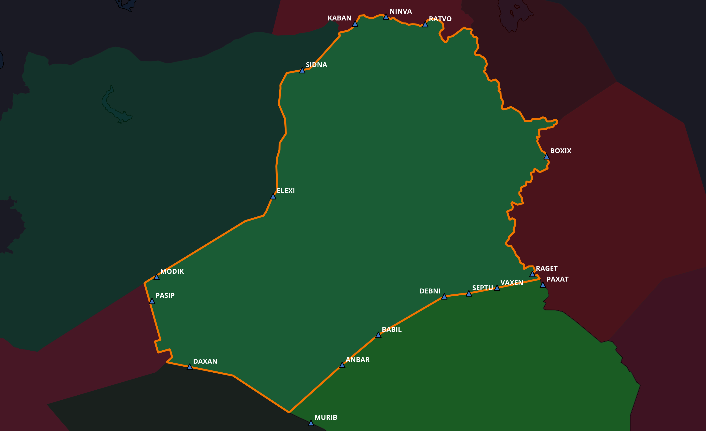

## Position Overview

| Radio Callsign  | Logon Callsign | Frequency | Levels (FL) | Class |
|-----------------|----------------|-----------|-------------|:-----:|
| Baghdad Control | ORBB_N_CTR     | 132.875   | 235 - 345   |   A   |

**Baghdad Control North Low (BN)** covers the North sector of the Baghdad FIR from FL235 to FL345. If **BNU** is not online, BN also covers North High (FL345 - FL460).

The North sector lies to the north and west of the line **VAXEN - SEPTU - DEBNI - BABIL - ANBAR**. It contains the procedural area in the west of the FIR. See the [Procedural page](Procedural.md).

## Top-down Services

When online, and the relevant approach and aerodrome positions are not, BN provides top-down services for:

- ORBI, ORBM, ORER, ORKK, ORSJ

Airports within the Kirkuk TMA (all, excluding ORBI) have standard procedures, though radar vectoring is preferred.

---

## FIR Entry and Exit Points

| Point | Adjacent FIR      | Airway(s)  |
|-------|-------------------|------------|
| MODIK | Damascus          | G202       |
| PASIP | Amman / Damascus  | L200, M703 |
| DAXAN | Jeddah            | R652       |
| ELEXI | Damascus          | L602       |
| SIDNA | Damascus          | P975       |
| NINVA | Ankara            | M860       |
| KABAN | Ankara            | L718       |
| RATVO | Ankara            | M688       |
| BOXIX | Tehran            | M434       |
| RAGET | Tehran            | G202, Z431 |

All aircraft entering or exiting the FIR at the same level shall be separated by **20 NM in trail**, constant or increasing. **80 NM** applies via PASIP and MODIK. See the [Procedural page](Procedural.md).

---

## Level Restrictions

| Airway | Segment       | Restriction                 |
|--------|---------------|-----------------------------|
| R652   | KASIR - GIBUX | Available FL285 and above   |
| R652   | DAXAN         | Cross at FL270 or below     |

---

## Coordination

!!! warning "To be confirmed"
    Handoff and agreed levels are provisional and may change.

Aircraft will be handed off by **Baghdad Control South (BS)** at RFL, or climbing to RFL. Aircraft should be handed off **~20 NM** prior to the sector boundary.

Departures from the Baghdad and Kirkuk TMAs will be handed off by **BGD_APP** and **KRK_APP** climbing **FL230**.

Arrivals into ORBI from the north should cross **SOBIL at FL350**. See the provisional [agreed levels for ORBI arrivals](../Terminal/BGD.md#agreed-levels-orbi-arrivals).

| Radio Callsign   | Logon Callsign | Frequency |
|------------------|----------------|-----------|
| Baghdad Control  | ORBB_S_CTR     | 128.700   |
| Baghdad Control  | ORBB_NU_CTR    | 125.900   |
| Baghdad Approach | BGD_APP        | 122.400   |
| Baghdad Approach | KRK_APP        | 127.700   |
