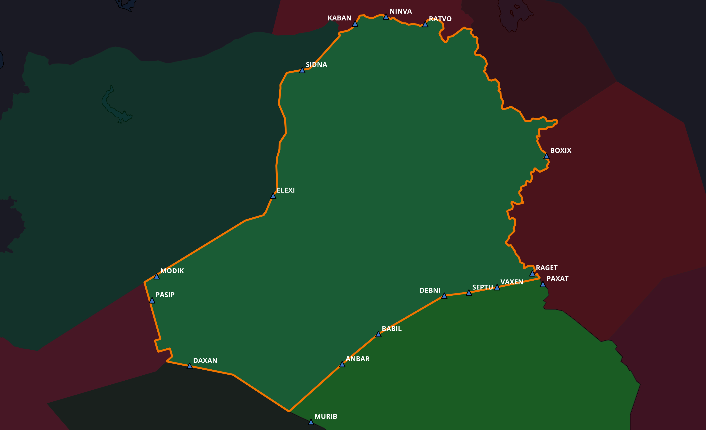

## Position Overview

| Radio Callsign  | Logon Callsign | Frequency | Levels (FL) | Class |
|-----------------|----------------|-----------|-------------|:-----:|
| Baghdad Control | ORBB_NU_CTR    | 125.900   | 345 - 460   |   A   |

**Baghdad Control North High (BNU)** covers the North sector of the Baghdad FIR from FL345 to FL460. If **BN** is not online, BNU also covers North Low (FL235 - FL345) and the top-down services listed on the [BN page](BN.md).

The lateral limits, FIR entry and exit points and level restrictions for the North sector are listed on the [BN page](BN.md).

!!! info "RVSM"
    RVSM applies up to and including **FL410**. Non-RVSM aircraft climbing to FL430 or above must be separated by **2 000 ft** from all other aircraft while passing through RVSM airspace, and may only level off within it if required by ATC.

---

## Coordination

Aircraft climbing or descending through FL345 should be coordinated with **BN**, or handed off once clear of conflicting traffic.

| Radio Callsign  | Logon Callsign | Frequency |
|-----------------|----------------|-----------|
| Baghdad Control | ORBB_N_CTR     | 132.875   |
| Baghdad Control | ORBB_SU_CTR    | 127.100   |
