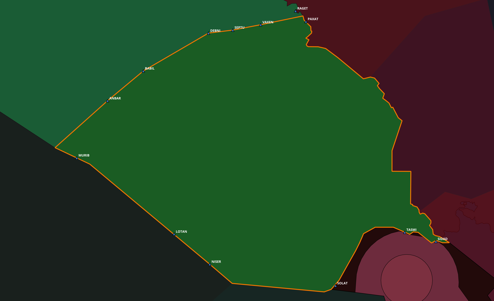

## Position Overview

| Radio Callsign  | Logon Callsign | Frequency | Levels (FL) | Class |
|-----------------|----------------|-----------|-------------|:-----:|
| Baghdad Control | ORBB_S_CTR     | 128.700   | 235 - 345   |   A   |

**Baghdad Control South Low (BS)** covers the South sector of the Baghdad FIR from FL235 to FL345. If **BSU** is not online, BS also covers South High (FL345 - FL460).

The South sector lies to the south and east of the line **VAXEN - SEPTU - DEBNI - BABIL - ANBAR**, and borders the Tehran, Kuwait and Jeddah FIRs.

## Top-down Services

When online, and the relevant approach and aerodrome positions are not, BS provides top-down services for:

- ORNI, ORMM

Only ORNI has standard procedures, which should be used to the greatest extent possible.

---

## FIR Entry and Exit Points

| Point | Adjacent FIR | Airway(s)  |
|-------|--------------|------------|
| TASMI | Kuwait       | L602       |
| SOLAT | Kuwait       | G669       |
| SIDAD | Kuwait       | M688, P975 |
| NISER | Jeddah       | G669       |
| MURIB | Jeddah       | B411       |
| LOTAN | Jeddah       | A424       |
| PAXAT | Tehran       | B411       |

All aircraft entering or exiting the FIR at the same level shall be separated by **20 NM in trail**, constant or increasing.

Aircraft landing in Bahrain should expect to cross **SIDAD at FL310 or FL330**.

---

## Level Restrictions

| Airway | Segment       | Restriction               |
|--------|---------------|---------------------------|
| A424   | SOBUK - LORAK | FL245 - FL285 unavailable |
| B411   | MURIB - RUKAM | FL245 - FL285 unavailable |
| M703   | RUKAM - ANBAR | FL245 - FL285 unavailable |
| T231   | SILBO - LOVEK | Available FL270 and above |
| G669   | NISER - SOLAT | Available FL240 and above |

---

## Coordination

!!! warning "To be confirmed"
    Handoff and agreed levels are provisional and may change.

Aircraft will be handed off by **Baghdad Control North (BN)** at RFL, or climbing to RFL. Aircraft should be handed off **~20 NM** prior to the sector boundary.

Departures from the Ali TMA will be handed off by **ALI_APP** climbing **FL230**. Baghdad Control should climb them further to their RFL.

Arrivals into ORBI from the south on **L602** should cross **UROKO at FL340** and **MUTLO at FL270**, to be at **FL170 at LOVEK**. See the provisional [agreed levels for ORBI arrivals](../Terminal/BGD.md#agreed-levels-orbi-arrivals).

| Radio Callsign   | Logon Callsign | Frequency |
|------------------|----------------|-----------|
| Baghdad Control  | ORBB_N_CTR     | 132.875   |
| Baghdad Control  | ORBB_SU_CTR    | 127.100   |
| Baghdad Approach | ALI_APP        | 120.200   |
| Kuwait Radar     | OKAC_CTR       | 125.300   |
