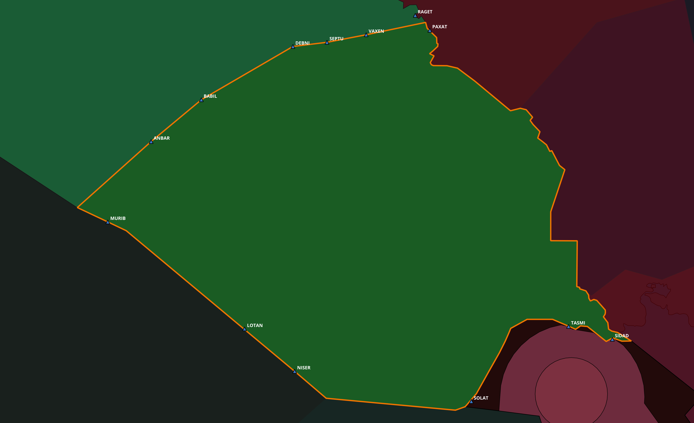

## Position Overview

| Radio Callsign  | Logon Callsign | Frequency | Levels (FL) | Class |
|-----------------|----------------|-----------|-------------|:-----:|
| Baghdad Control | ORBB_SU_CTR    | 127.100   | 345 - 460   |   A   |

**Baghdad Control South High (BSU)** covers the South sector of the Baghdad FIR from FL345 to FL460. BSU only ever covers South High. It never covers South Low (FL235 - FL345) or provides top-down services, even if **BS** is not online.

The lateral limits, FIR entry and exit points and level restrictions for the South sector are listed on the [BS page](BS.md).

!!! info "RVSM"
    RVSM applies up to and including **FL410**. Non-RVSM aircraft climbing to FL430 or above must be separated by **2 000 ft** from all other aircraft while passing through RVSM airspace, and may only level off within it if required by ATC.

---

## Coordination

Aircraft climbing or descending through FL345 should be coordinated with **BS**, or handed off once clear of conflicting traffic.

| Radio Callsign  | Logon Callsign | Frequency |
|-----------------|----------------|-----------|
| Baghdad Control | ORBB_S_CTR     | 128.700   |
| Baghdad Control | ORBB_NU_CTR    | 125.900   |
