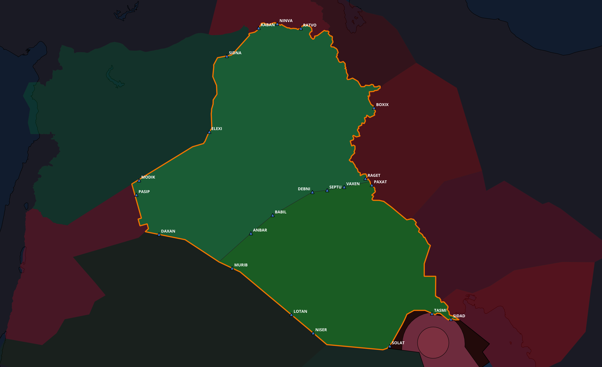

Welcome to the Baghdad Control section. This section provides information on the sector splits and general enroute procedures within the Baghdad (ORBB) FIR.

## Enroute Airspace Structure

Baghdad ACC is responsible for all controlled airspace within the Baghdad FIR from **FL235 to FL460**. The airspace is split laterally into a **North** and a **South** sector, each of which may be split vertically into a **Low** and a **High** sector.

The following positions, for Baghdad ACC, are defined in the table below.

| ID  | Logon Callsign        | Frequency | Sector     | Levels (FL) |
|-----|-----------------------|-----------|------------|-------------|
| B   | ORBB_CTR              | 124.400   | Bandbox    | 235 - 460   |
| BN  | [ORBB_N_CTR](BN.md)   | 132.875   | North Low  | 235 - 345   |
| BS  | [ORBB_S_CTR](BS.md)   | 128.700   | South Low  | 235 - 345   |
| BNU | [ORBB_NU_CTR](BNU.md) | 125.900   | North High | 345 - 460   |
| BSU | [ORBB_SU_CTR](BSU.md) | 127.100   | South High | 345 - 460   |

### North and South Boundary

The boundary between the North and South sectors runs from the Tehran FIR boundary at **332610N 0460200E**, then via **VAXEN - SEPTU - DEBNI - BABIL - ANBAR** to the Jeddah FIR boundary at **312325N 0412439E**.

Airspace to the north and west of this line belongs to the North sector. Airspace to the south and east of this line belongs to the South sector.

### Top-down Coverage

**B** covers all four sectors. Each split sector that opens takes its airspace from B, so when BN, BNU, BS and BSU are all online, B controls nothing.

If a split sector is not online, its airspace is covered by the next available position in the order below. **BN** and **BS** cover the High sectors when **BNU** or **BSU** is offline. **BNU** and **BSU** only ever cover the High sectors. They never cover the Low sectors or provide top-down services.

| Sector     | Coverage Order    |
|------------|-------------------|
| North Low  | BN → B            |
| North High | BNU → BN → B      |
| South Low  | BS → B            |
| South High | BSU → BS → B      |

When online, Baghdad Control also provides top-down services to the Baghdad Approach sectors and aerodromes that are not staffed. See [Baghdad Approach](../Terminal/Baghdad%20Approach.md) for which aerodromes fall under each approach sector.

---

## Airspace Classification

| Airspace                                | Class | Vertical Limits |
|-----------------------------------------|:-----:|-----------------|
| Baghdad ACC (North and South sectors)   |   A   | FL235 - FL460   |
| ATS routes below FL235                  |   E   | Below FL235     |
| TMAs and CTRs                           |   D   | See [Baghdad Approach](../Terminal/Baghdad%20Approach.md) |
| All other airspace                      |   G   | -               |

Class A airspace is **IFR only**. Classes B, C and F are not used in the Baghdad FIR.

---

## Transition Altitude and Level

A common transition altitude and transition level are established for the whole of the Baghdad FIR.

| **Transition Altitude** | **Transition Level**                   |
|:-----------------------:|:--------------------------------------:|
|         14 000 ft        | FL160 (FL170 when QNH is below 980 hPa) |

---

## Cruising Levels

Cruising levels are assigned according to the **semicircular rule**, based on the aircraft's magnetic track:

| Magnetic Track | IFR Levels                         |
|----------------|------------------------------------|
| 000° - 179°    | Odd levels (FL250, FL270, FL290...) |
| 180° - 359°    | Even levels (FL240, FL260, FL280...) |

### Overflights
Overflights of the Baghdad FIR must operate **above FL200**, unless a lower level is issued by ATC.

### RVSM
RVSM applies between **FL290 and FL410 inclusive**. Only RVSM-approved aircraft may operate within RVSM airspace. Non-RVSM aircraft (e.g. State aircraft, or aircraft climbing through to FL430 or above) shall be separated by **2 000 ft** from all other aircraft within RVSM airspace.

### Unavailable Levels
Some route segments are only available above a certain level. These are listed on the sector pages and on the [Procedural page](Procedural.md).

---

## Supplementary Services

Prior to being provided with radar service, an ATCO unit will establish identification of the aircraft concerned. A pilot will be informed whenever radar identification is established or lost.

> Controller: "IAW123, radar contact/identified"

> Controller: "Radar contact/identification lost"

!!! info "Radar Control Service"
    A radar control service will be provided in all controlled airspace within the Baghdad FIR, and along all airways except segments of airways in the west of the Baghdad FIR.
    Information regarding this can be found in the ['Procedural' page](Procedural.md).

### Separation
The minimum horizontal radar separation en route along airways is **5 NM**. Vertical separation is **1 000 ft** within RVSM airspace, and **2 000 ft** involving any non-RVSM aircraft above FL290.

---

## Flow Management

The following flow measures apply to all traffic entering or leaving the Baghdad FIR:

- All aircraft entering or exiting the Baghdad FIR at the same level shall be separated by **20 NM in trail**, constant or increasing.
- Traffic via **PASIP** or **MODIK** requires **80 NM in trail**. See the [Procedural page](Procedural.md).
- All aircraft entering the Baghdad FIR on **R652** shall cross **DAXAN at FL270 or below**.
- Aircraft landing in Bahrain should expect to cross **SIDAD at FL310 or FL330**.

---

## Emergency Squawks

| Squawk | Meaning                |
|:------:|------------------------|
|  7700  | Emergency              |
|  7600  | Radio failure          |
|  7500  | Unlawful interference  |

Aircraft entering the Baghdad FIR without a code assigned by ATC should be squawking **2000**.

In the event of radio failure, aircraft will maintain their last assigned level (or minimum flight altitude if higher) for **3 minutes**, then continue as per their flight plan.
