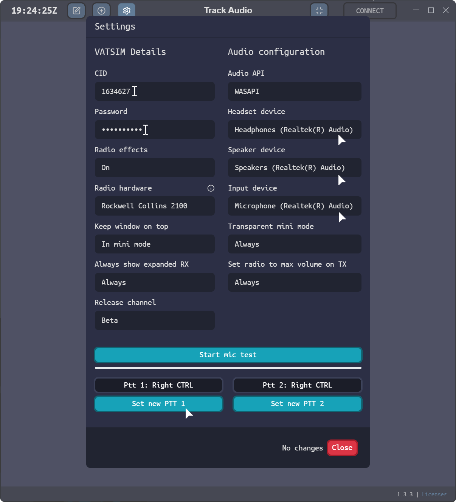

**Download Link:** [TrackAudio version 1.3.3](https://github.com/pierr3/TrackAudio/releases/tag/1.3.3 "Opens in new tab"){target="_blank"}

## What is TrackAudio?
TrackAudio is a next generation Audio for VATSIM ATC client for macOS, Linux and Windows.

## Setting up TrackAudio

- Input your VATSIM details
  * Your VATSIM CID
  * Your VATSIM password
- Audio configuration
  * Select a headset, speaker and input device
- Set a Push-To-Talk (PTT) bind
- Save your changes by pressing 'Close' on the bottom right

### Extra Settings

TrackAudio offers extra options that you can configure. These do not affect your ability to receive and transmit on frequency, but can improve your experience.

## Connecting and Transmitting on Frequency

- Open TrackAudio. If set up correctly and connected to VATSIM, you will see a green 'CONNECT' button.
- Once connected, you will see the position you have logged on as at the top. If your callsign is correct, the frequencies will populate automatically.
- Click 'TX' (transmit) to both receive and transmit on the selected frequency.
- Use your selected PTT button to transmit on the frequency.

## Adding a New Frequency

- To RX, TX or XC a different frequency, type the station callsign into the add station box at the top of the client and add it.

## Cross-Coupling Frequencies

Cross-coupling allows transmissions on one transceiver to be re-emitted by other transceivers. See '[What is XC and XCA?](https://github.com/pierr3/TrackAudio#what-is-xc-and-xca "Opens in new tab"){target="_blank"}' for more.

- To cross-couple a frequency, click the 'XC' button next to each frequency you wish to cross-couple. You **must click the 'XC' button for all concerned frequencies.**
- Click 'XCA' to receive, transmit and couple all the transceivers of a frequency together in one button.

## Observing

When connecting as an observer, you will only be able to receive (RX) on frequencies.

- To listen to a frequency, add the station as described in [Adding a New Frequency](#adding-a-new-frequency) and click on the 'RX' button.

Still having issues with TrackAudio? Feel free to ask for help in one of our channels in the Kuwait & Iraq vACC Discord server, which can be found in the [VATSIM Community Hub](https://community.vatsim.net/ "Opens in new tab"){target="_blank"}.
