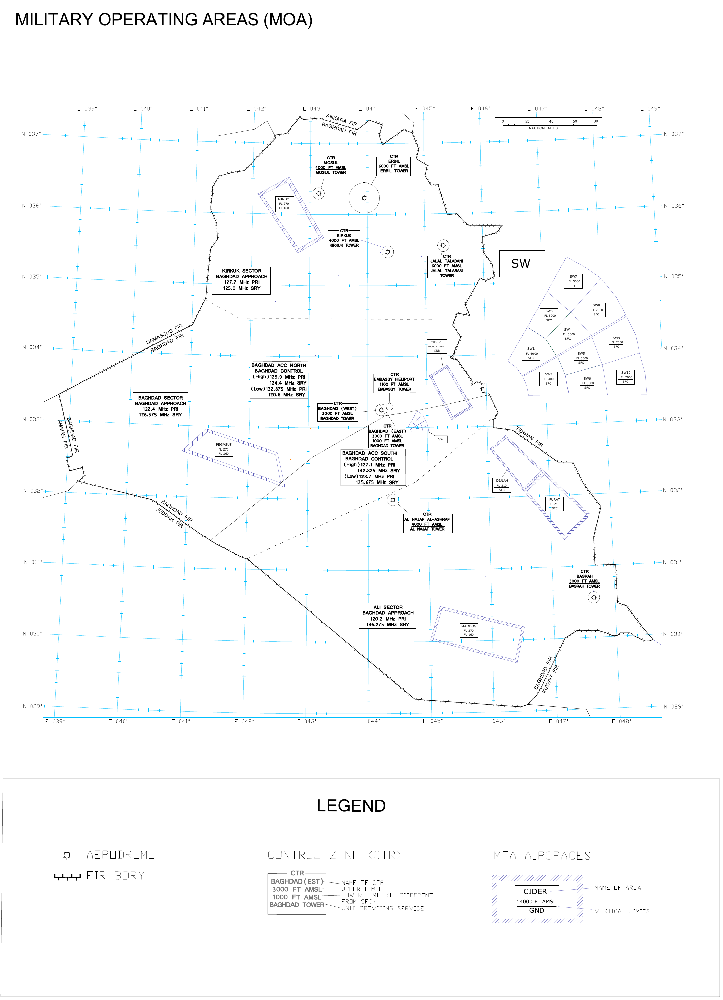

# PRC-ORBB-26-004 — Baghdad Approach Training Areas SW1-SW10

| Reference                     | PRC-ORBB-26-004                                       |
| ----------------------------- | ----------------------------------------------------- |
| **Effective Date**            | 26/11/2026                                            |
| **Status**                    | Active     |
| **Applies To**                | Baghdad Approach (BGD)                                |
| **Docs Updated**              | Yes                                                   |

<!-- more -->

## Summary

Iraq AIP Amendment 11/26 takes effect with AIRAC 2612. It adds ten training areas, SW1 to SW10, south-east of ORBI.

| Area | Vertical Limits |
| ---- | --------------- |
| SW1, SW2 | SFC - 4000ft |
| SW3 - SW7 | SFC - 5000ft |
| SW8 - SW10 | SFC - 7000ft |

*Source: Iraq AIP AMDT 11/26, ENR 6-4.*

## Controller Actions

- **Expect traffic in SW1 to SW10.** Aircraft must contact Baghdad Approach before entering, and contact ATC after departing ORSW.

## Documentation Status

The training areas are on the [BGD](../../../../Baghdad%20FIR/Terminal/BGD.md) page.

The training areas were added to the sector file in the AIRAC 2612 release.

---

Spotted an error, or want to suggest a change? Email [operations@kuwait-iraqvacc.net](mailto:operations@kuwait-iraqvacc.net?subject=Documentation%20Change%20-%20PRC-ORBB-26-004)
