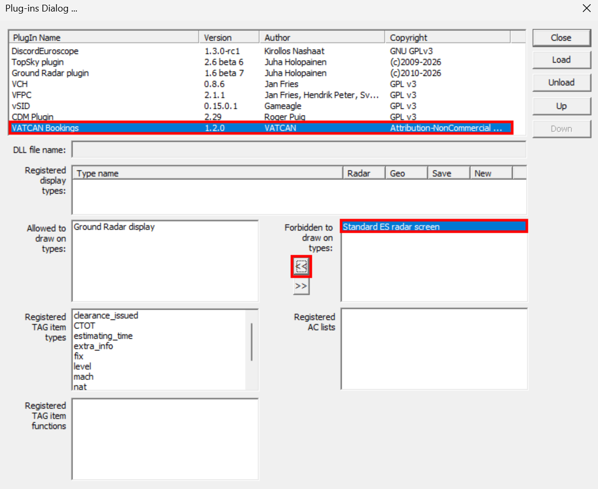

VATCAN Bookings is a simple to use event booking system. Use the EuroScope plugin to see which aircraft are **event** & **non-event** aircraft.   The VATCAN Bookings plugin tells you if an aircraft is a booked flight or not, and can also provide you with that aircraft's slot time.

## How do I use VATCAN?

In order for VATCAN to work, you will need to draw the plugin onto your EuroScope screen. Here's how to achieve that:

1. Navigate to Other Set > Plug-ins...
2. Here, you will find all the plugins within the sector file. Find 'VATCAN Bookings' and click on it.
3. In the dialogue you will find multiple boxes. Navigate to 'Forbidden to draw on types'.
4. Click on the type you want to allow it to draw on. Recommendation is to allow to draw on ALL options.
5. Use the << arrow in the middle to move it to the 'Allow to draw on types' section.

## How do I use the code?

Once the plugin is drawn on your screen, you will be able to enter the code provided by the events team by clicking on 'Enter Code'.

After entering the code, it will turn green.

## How do I know if an aircraft is event or non-event?
If an aircraft has a slot, then they will have an orange EVT show under their track.

## How do I know an aircraft's slot time?
Slot times will show up in the startup, departure, and combined taxi out lists. This will be under either EVNT or CTOT.